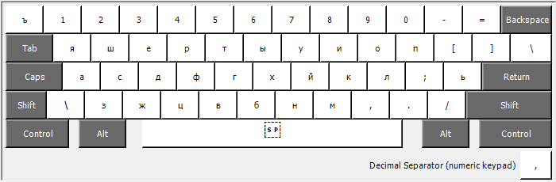
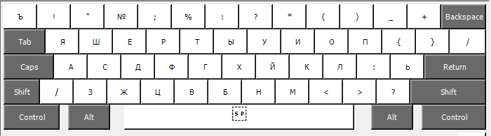
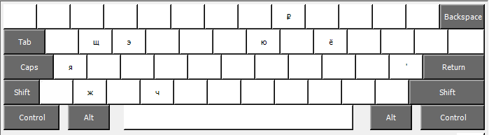
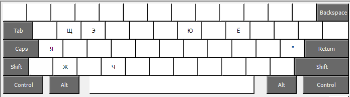

# ru-translit
Русская транслит-раскладка клавиатуры

Альтернативная мнемоническая раскладка клавиатуры, в которой, по сравнению с раскладкой, доступной "из коробки", метод ввода ряда букв, требовавших "слепых клавиш", заменен на использование AltGr.

## Преимущества

- Более быстрый ввод русского текста на латинской клавиатуре за счет отсутствия двойных нажатий.
- Отсутствуют постоянно ломающиеся в приложениях "слепые клавиши".
- Символы вводятся сразу, без задержек.

## Недостатки

- Использование клавиши AltGr может подходить не всем, особенно людям с ограниченными возможностями.

## Карты раскладки:
Базовая:

Shift:

AltGr:

AltGr + Shift:

## Установка
- Простой путь: распаковка архива Translit.zip, запуск Setup.exe
- Сложный путь: установка программы Microsoft (R) Keyboard Layout Creator, загрузка файла Translit.klc, при желании - модификация, сборка инсталлятора, установка.
